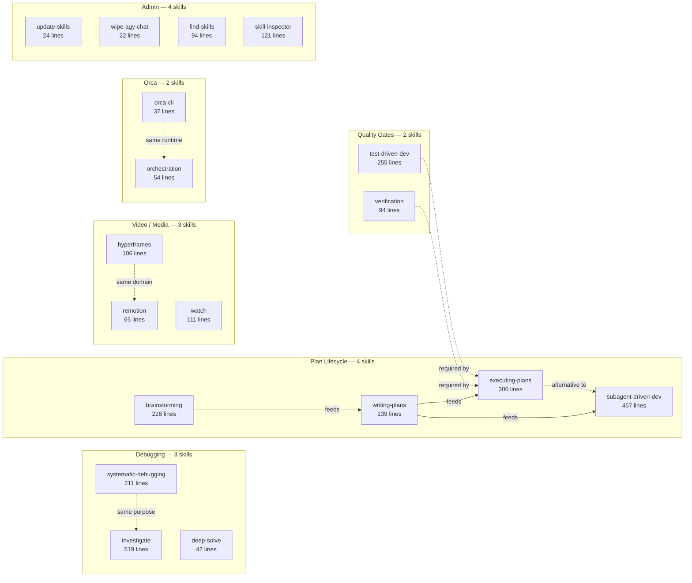

# Skill Router Consolidation Analysis

> **Scope:** `C:\aiWorkspace\.agents\skills\` — 26 skills shared across local AI harnesses (Antigravity, Pi/Hermes, Claude Code, Codex, Orca, Muse).
> **Purpose:** Reduce the number of skills loaded into context at session start. Fewer top-level skills means fewer description tokens in every harness prompt.

---

## 1. System Context

### Inference Topology (Port Map)

| Port | Service | Device | Model |
|------|---------|--------|-------|
| 8080 | Unified Gateway (FastAPI) | — | Routes to backends |
| 8081 | CPU llama-server (Director) | CPU | Gemma 4 12B Vision QAT `-ngl 0` |
| 8082 | CPU Reranker | CPU | `BAAI/bge-reranker-v2-m3` |
| 8083 | CPU von System One Gater | CPU | `wfzyx/von` (ModernBERT ONNX) |
| 8084 | CPU Decider-4B v2.1 | CPU | `Mapika/decider-4b-v2.1` (GGUF/ONNX) |
| 8085 | Signal daemon | — | — |
| 9940 | Blackwell gRPC shim | GPU | Qwen 3.8 27B (Blackwell `sm_120`) |
| 9941 | TabbyAPI EXL3 shim | GPU | Qwen3.8-27B / Muse-Glimmer-30B |
| 9942 | FreeToken NVFP4 shim | GPU | nvidia Qwen3.6-35B-A3B |
| 9943 | Strata gRPC shim | GPU | Qwen3.8-Flash-Next 125B MoE |
| 9934 | Strata inference engine | GPU | Qwen3.8-Flash-Next 125B MoE |
| 20128 | OmniRoute Token Proxy | — | — |

### CPU Auxiliary Microservices (0 MB GPU VRAM)

Three dedicated CPU microservices run in DDR5 host RAM. They are the infrastructure that the `cpu-tools` skill documents for agents.

1. **CPU Reranker** (Port 8082): `BAAI/bge-reranker-v2-m3`. Cross-encoder passage ranking in ~25ms. Guardrail: whole source files (>3,000 tokens) bypass reranking to prevent truncation distortion.

2. **CPU von System One Gater** (Port 8083): `wfzyx/von`. ModernBERT-based non-autoregressive encoder. Sub-15ms discrete choice (PASS/FAIL, ALLOW/BLOCK), boolean noul evaluation, score grading, safety tripwires, and fast-path tool shortlisting. Replaces the deprecated `open-jev-deberta-v3-large` and `CLM-8B` models.

3. **CPU Decider-4B v2.1** (Port 8084): `Mapika/decider-4b-v2.1`. Schema-first multi-slot parallel extraction, Mind2Web/MiniWoB++ DOM accessibility probes, and softened MCTS rollout policy priors. Evaluates complex state distributions in 1 forward pass with 0 MB GPU VRAM.

### Deprecated Models (Removed from Codebase)
- `Contrastive-LM/CLM-v0.1-8B` — zero-shot tool shortlisting via dual ONNX projection heads. Replaced by von's built-in `shortlist_tools()`.
- `com-kotobalabs/open-jev-deberta-v3-large` — discrete gating. Replaced by `wfzyx/von`.

---

## 2. Skill Inventory

| # | Skill | SKILL.md Lines | Total Files | Domain | Suite |
|---|-------|---------------:|----------:|--------|-------|
| 1 | `brainstorming` | 226 | 8 | Planning / Design | superpowers |
| 2 | `cpu-tools` | 103 | 1 | CPU Microservice Interface | local_ai_launcher |
| 3 | `deep-solve` | 42 | 1 | Algorithmic Solving (GVS5H) | local_ai_launcher |
| 4 | `executing-plans` | 300 | 3 | Plan Execution (Inline) | superpowers |
| 5 | `find-skills` | 94 | 1 | Skill Discovery | standalone |
| 6 | `gstack` | 188 | 2,513 | Router: QA/Ship/Review/Debug | gstack suite |
| 7 | `humanizer` | 310 | 14 | AI Prose Cleanup | standalone |
| 8 | `hyperframes` | 106 | 29 | Video: HyperFrames Compositions | hyperframes suite |
| 9 | `impeccable` | 65 | 3,350 | Router: Frontend/UI Design | impeccable suite |
| 10 | `investigate` | 519 | 2 | Debugging (gstack) | gstack suite |
| 11 | `last30days` | 1,740 | 135 | Social Media Research | standalone |
| 12 | `learn` | 399 | 2 | gstack Knowledge Management | gstack suite |
| 13 | `orca-cli` | 37 | 1 | Orca Worktree Stub | orca |
| 14 | `orchestration` | 54 | 1 | Orca Multi-Agent Stub | orca |
| 15 | `reliable-file-read` | 43 | 1 | Unicode Path Resolution | local_ai_launcher |
| 16 | `remotion-best-practices` | 65 | 14 | Video: Remotion Router | remotion suite |
| 17 | `skill-inspector` | 121 | 404 | Skill Safety Audit | standalone |
| 18 | `subagent-driven-development` | 457 | 7 | Plan Execution (Subagents) | superpowers |
| 19 | `systematic-debugging` | 211 | 11 | Debugging (superpowers) | superpowers |
| 20 | `test-driven-development` | 255 | 2 | TDD Discipline | superpowers |
| 21 | `update-skills` | 24 | 1 | Skill Suite Updater | local_ai_launcher |
| 22 | `using-superpowers` | 46 | 8 | Meta: Skill Invocation Loader | superpowers |
| 23 | `verification-before-completion` | 94 | 1 | Verification Gate | superpowers |
| 24 | `watch` | 111 | 71 | Video Analysis | standalone |
| 25 | `wipe-agy-chat` | 22 | 2 | AGY History Cleanup | local_ai_launcher |
| 26 | `writing-plans` | 139 | 1 | Implementation Plan Authoring | superpowers |

**Total SKILL.md lines across 26 skills: ~5,776**

---

## 3. Overlap Map



### Overlap Details

| Group | Skills | Why They Overlap | Combined Lines |
|-------|--------|-----------------|---------------:|
| **Debugging** | `systematic-debugging` + `investigate` + `deep-solve` | All serve "something is broken or stuck." `systematic-debugging` is the superpowers version, `investigate` is gstack's, `deep-solve` is a heavy solver. A user says "debug this" and does not choose between them. | 772 |
| **Plan lifecycle** | `brainstorming` + `writing-plans` + `executing-plans` + `subagent-driven-development` | Strict pipeline: ideate → plan → execute. Only one phase runs at a time. | 1,122 |
| **Quality gates** | `test-driven-development` + `verification-before-completion` | Both are mandatory sub-skills of `executing-plans` and `subagent-driven-development`. They are never invoked standalone by a user. | 349 |
| **Video / media** | `hyperframes` + `remotion-best-practices` + `watch` | All serve "make or analyze video." `hyperframes` and `remotion` are alternative creation frameworks; `watch` is consumption. Mutually exclusive per request. | 282 |
| **Orca** | `orca-cli` + `orchestration` | Both are thin stubs that load their real instructions from `orca skills get`. Near-identical CLI resolution preambles. | 91 |
| **Admin / meta** | `update-skills` + `wipe-agy-chat` + `find-skills` + `skill-inspector` | Maintenance tasks triggered only by explicit user commands, never by natural coding conversation. | 261 |

---

## 4. Token Impact

### Current cost (26 skills)

| Component | Tokens |
|-----------|-------:|
| 26 skill names + description frontmatter in discovery prompt | ~1,100 |
| Full SKILL.md reads on trigger (avg 2 per session) | ~2,500 |
| **Baseline per-session overhead (before any user work)** | **~1,100** |

### Projected cost (14 top-level entries after consolidation)

| Component | Tokens |
|-----------|-------:|
| 14 router/skill names + descriptions | ~400 |
| Router SKILL.md read on trigger (avg 1.5) | ~1,200 |
| Lazy-loaded sub-skill SKILL.md (avg 1) | ~800 |
| **Baseline per-session overhead** | **~400** |

**Savings: ~700 tokens at session start (64% reduction).**

---

## 5. Proposed Routers

### Router 1: `plan-and-build`
**Replaces:** `brainstorming`, `writing-plans`, `executing-plans`, `subagent-driven-development`

```yaml
description: >-
  Plan and build features end-to-end: brainstorm ideas, write specs, create
  implementation plans, and execute them inline or via subagents.
```

**Routing logic:**
- No plan exists → load `brainstorming`
- Spec exists, no plan → load `writing-plans`
- Plan exists + subagent tool available → load `subagent-driven-development`
- Plan exists + no subagent tool or inline chosen → load `executing-plans`

These are a strict pipeline. No session runs more than one phase.

---

### Router 2: `code-quality`
**Replaces:** `test-driven-development`, `verification-before-completion`

```yaml
description: >-
  TDD discipline and verification gates. Governs test-first implementation
  and evidence-before-claims completion checks.
```

**Routing logic:**
- Implementation in progress → load `test-driven-development`
- About to claim completion → load `verification-before-completion`

Both are mandatory sub-skills of `executing-plans` / `subagent-driven-development`. They are never invoked independently.

---

### Router 3: `debug`
**Replaces:** `systematic-debugging`, `investigate`, `deep-solve`

```yaml
description: >-
  Debug and diagnose issues: root-cause investigation, systematic debugging,
  and heavy algorithmic solving via GVS5H.
```

**Routing logic:**
- General bug / test failure / broken behavior → load `systematic-debugging`
- gstack session with prior investigation history → load `investigate`
- Complex algorithm or repeated single-turn failure → load `deep-solve`

Users say "fix this" or "debug this." The router picks the right methodology.

---

### Router 4: `video-media`
**Replaces:** `hyperframes`, `remotion-best-practices`, `watch`

```yaml
description: >-
  Create, edit, or analyze video and motion graphics. Covers HyperFrames
  compositions, Remotion projects, and video analysis.
```

**Routing logic:**
- Watch / analyze existing video → load `watch`
- Existing Remotion project or explicit Remotion request → load `remotion-best-practices`
- All other video creation → load `hyperframes` (default framework)

---

### Router 5: `orca`
**Replaces:** `orca-cli`, `orchestration`

```yaml
description: >-
  Orca worktree management and multi-agent orchestration: handoffs,
  task DAGs, terminal control, and coordinated worker dispatch.
```

**Routing logic:**
- Handoff / worktree / browser / terminal → load `orca-cli`
- Supervised DAG / threaded coordination → load `orchestration`

Both are stubs that load real content from `orca skills get`.

---

### Router 6: `admin`
**Replaces:** `update-skills`, `wipe-agy-chat`, `find-skills`, `skill-inspector`

```yaml
description: >-
  Workspace maintenance and skill management: update installed skills,
  wipe chat history, discover new skills, or audit skills for safety.
```

**Routing logic:**
- "Update skills" → load `update-skills`
- "Wipe chat" / "clear history" → load `wipe-agy-chat`
- "Find a skill for X" → load `find-skills`
- "Is this skill safe" → load `skill-inspector`

All four are explicit-command-only. They never fire from normal coding conversation.

---

### Unchanged Skills (stay as top-level entries)

| Skill | Why It Stays |
|-------|-------------|
| `gstack` | Already a router — dispatches to 30+ gstack sub-skills |
| `using-superpowers` | Meta-loader — must run at session start to govern all skill invocation |
| `cpu-tools` | Infrastructure reference — documents the 3 CPU microservice APIs agents call directly |
| `humanizer` | Unique domain — prose editing, no overlap with anything else |
| `impeccable` | Already a router — dispatches to 18+ UI design sub-commands |
| `reliable-file-read` | Micro-skill (43 lines) — too small to route, triggered on path errors |
| `learn` | gstack sub-skill — triggered by explicit "show learnings" |
| `last30days` | Unique domain — social media research, no overlap |

---

## 6. Before vs. After

| Metric | Before | After | Change |
|--------|-------:|------:|-------:|
| Top-level skills in discovery prompt | 26 | 14 | **-12 (-46%)** |
| Description tokens at session start | ~1,100 | ~400 | **-700 (-64%)** |
| Avg SKILL.md lines loaded per invocation | ~400 | ~280 | **-30%** |

---

## 7. Proposed Directory Layout

```
.agents/skills/
├── admin/                          ← NEW ROUTER (4 sub-skills)
│   ├── SKILL.md                    (~30 lines)
│   └── sub/
│       ├── find-skills/
│       ├── skill-inspector/
│       ├── update-skills/
│       └── wipe-agy-chat/
├── code-quality/                   ← NEW ROUTER (2 sub-skills)
│   ├── SKILL.md                    (~25 lines)
│   └── sub/
│       ├── test-driven-development/
│       └── verification-before-completion/
├── cpu-tools/                      (unchanged)
├── debug/                          ← NEW ROUTER (3 sub-skills)
│   ├── SKILL.md                    (~35 lines)
│   └── sub/
│       ├── deep-solve/
│       ├── investigate/
│       └── systematic-debugging/
├── gstack/                         (unchanged — already a router)
├── humanizer/                      (unchanged)
├── impeccable/                     (unchanged — already a router)
├── last30days/                     (unchanged)
├── learn/                          (unchanged)
├── orca/                           ← NEW ROUTER (2 sub-skills)
│   ├── SKILL.md                    (~25 lines)
│   └── sub/
│       ├── orca-cli/
│       └── orchestration/
├── plan-and-build/                 ← NEW ROUTER (4 sub-skills)
│   ├── SKILL.md                    (~40 lines)
│   └── sub/
│       ├── brainstorming/
│       ├── executing-plans/
│       ├── subagent-driven-development/
│       └── writing-plans/
├── reliable-file-read/             (unchanged)
├── using-superpowers/              (unchanged)
└── video-media/                    ← NEW ROUTER (3 sub-skills)
    ├── SKILL.md                    (~30 lines)
    └── sub/
        ├── hyperframes/
        ├── remotion-best-practices/
        └── watch/
```

---

## 8. Migration Risks

| Risk | Mitigation |
|------|------------|
| Harness configs reference old skill paths | Add symlinks from old names to `router/sub/old-name/` |
| Pi harness auto-discovers skills by ancestor directory walk | Place sub-skills under `sub/` — Pi walks one level by default |
| `executing-plans` references `../subagent-driven-development/scripts/` | Keep scripts at original relative position or create symlink |
| gstack SKILL.md references `../systematic-debugging/` | Symlink `../debug/sub/systematic-debugging/` at the old path |
| Claude Code hooks reference skill paths in `~/.claude/settings.json` | Update hook paths after migration |

---

## 9. Implementation Priority

| Priority | Action | Effort | Savings |
|----------|--------|--------|---------|
| **P0** | Create `admin` router | Low — 4 rare, command-only skills | ~200 tokens |
| **P0** | Create `code-quality` router | Low — 2 always-paired skills | ~150 tokens |
| **P1** | Create `orca` router | Low — 2 thin stubs | ~80 tokens |
| **P1** | Create `video-media` router | Medium — 3 skills, need routing logic | ~120 tokens |
| **P2** | Create `debug` router | Medium — must route between superpowers/gstack/GVS5H | ~150 tokens |
| **P2** | Create `plan-and-build` router | High — 4-phase pipeline with cross-references | ~200 tokens |

P0 items are safe, low-effort wins. The admin skills are never triggered by conversation, and code-quality skills already load as a pair. These two routers alone save ~350 tokens.

---

## 10. Alternative: von Tool Shortlisting

The `cpu-tools` skill exposes von's `shortlist_tools()` function (~12ms, CPU-only). Instead of static routers, a harness could dynamically shortlist at runtime:

1. Register all 26 skill names + descriptions as tool candidates
2. On each user turn, call `shortlist_tools(state=user_message, tools=skill_names, top_k=3)`
3. Load only the top-3 SKILL.md files into context

**Pros:** No manual routing, adapts to new skills automatically.
**Cons:** Adds ~12ms per turn, requires von microservice on port 8083, less predictable than static routers.

**Recommendation:** Use static routers (this document) for harness-level discovery. Reserve von shortlisting for runtime skill selection within routers that have many sub-skills (e.g., `gstack` routing across 30+ children).

---

## 11. Cross-Reference: User-Level Skills

`C:\Users\user\.gemini\config\skills\` contains 37 additional user-level skills. Five overlap with workspace skills:

| User-level | Workspace equivalent | Resolution |
|-----------|---------------------|------------|
| `tdd` | `test-driven-development` | Deduplicate — keep workspace version |
| `diagnosing-bugs` | `systematic-debugging` + `investigate` | Fold into `debug` router |
| `clear-chat-history` | `wipe-agy-chat` | Deduplicate — keep one |
| `code-review` | gstack `/review` | Keep both — different scope |
| `research` | `last30days` | Keep both — different purpose |

A follow-up pass on user-level skills would yield similar consolidation opportunities. The 37 user-level skills add another ~1,500 tokens of description overhead at session start.
